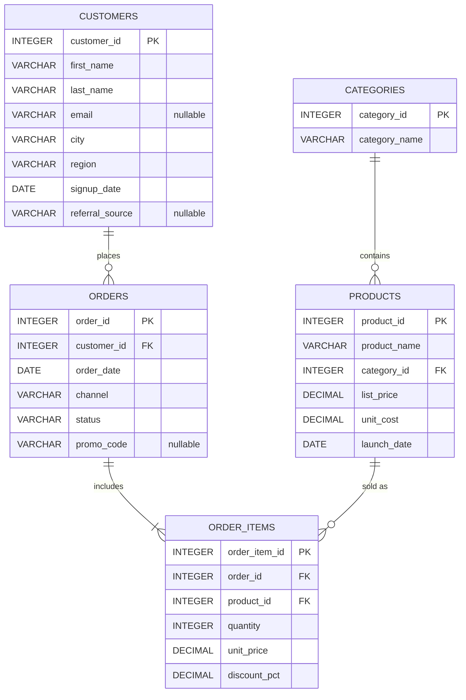
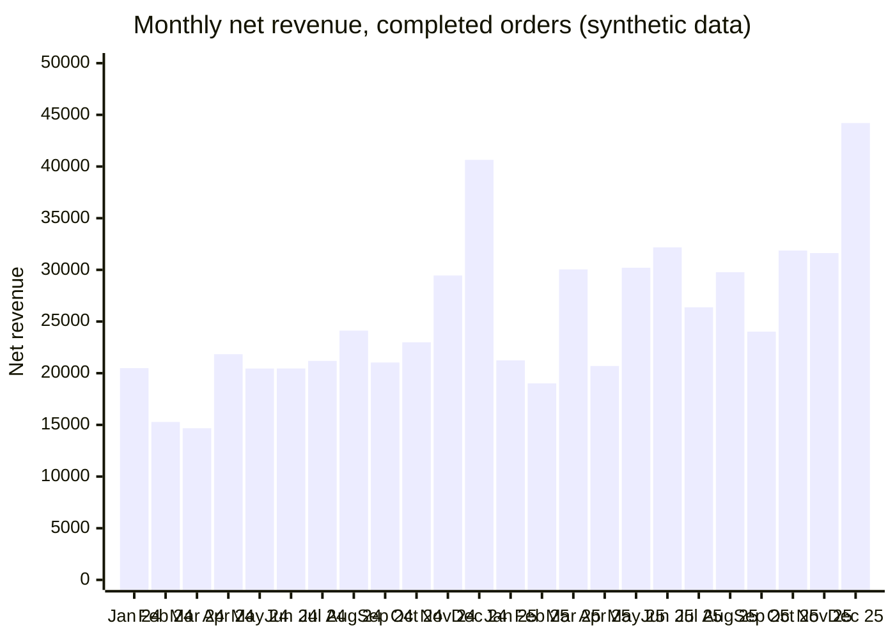

# Retail SQL Analytics

A practical SQL analytics project exploring retail sales, revenue trends, product performance, customer purchasing patterns, and business KPIs.

The project models a small multi-category retailer, loads its transactions into [DuckDB](https://duckdb.org/), and answers business questions with plain, well-structured SQL, progressing from basic filtering and aggregation to CTEs, subqueries, and window functions. Every query runs against the included dataset and the key metrics are checked by an automated test suite against independent calculations.

> **Synthetic data notice:** the dataset is generated by [`scripts/generate_sample_data.py`](scripts/generate_sample_data.py) with a fixed random seed. All customers, products, and transactions are fictional. The findings below describe this simulated dataset only and are not real-world business results.

## Contents

- [Business Problem](#business-problem)
- [Technology Stack](#technology-stack)
- [Dataset](#dataset)
- [Data Schema and Relationships](#data-schema-and-relationships)
- [Repository Structure](#repository-structure)
- [Installation and Setup](#installation-and-setup)
- [Generating the Sample Data](#generating-the-sample-data)
- [Running the SQL Queries](#running-the-sql-queries)
- [SQL Concepts Demonstrated](#sql-concepts-demonstrated)
- [Business Questions Answered](#business-questions-answered)
- [Metric Definitions and Assumptions](#metric-definitions-and-assumptions)
- [Findings](#findings)
- [Testing](#testing)
- [Limitations and Potential Improvements](#limitations-and-potential-improvements)

## Business Problem

A retailer selling across web, mobile app, and physical stores needs a clear, repeatable view of its performance over 2024 and 2025:

- How much revenue does the business generate, and how is it trending month to month and year over year?
- Which products and categories drive revenue and margin?
- How loyal are customers, and how concentrated is revenue among them?
- What do promotions, cancellations, and returns cost the business?

The SQL in this repository turns raw order data into the KPIs and breakdowns needed to answer these questions.

## Technology Stack

| Tool | Purpose |
| --- | --- |
| DuckDB 2.0 | In-process analytical SQL engine; no server or paid service required |
| Python 3.10+ | Deterministic data generation, data loading, and the query runner |
| pytest | Data integrity, query execution, and metric validation tests |

All tools are free and open source. The only Python dependencies are `duckdb` and `pytest`.

## Dataset

The sample lives in [`data/sample/`](data/sample) as five CSV files (about 460 KB in total):

| Table | Rows | Description |
| --- | ---: | --- |
| `categories` | 8 | Product categories such as Electronics, Apparel, and Grocery |
| `products` | 64 | Catalog with list price, unit cost, and launch date |
| `customers` | 600 | Customers with region, signup date, optional email, and optional referral source |
| `orders` | 4,496 | Orders from 2024-01-01 to 2025-12-31 with channel, status, and optional promo code |
| `order_items` | 9,218 | Order lines with quantity, unit price, and discount rate |

The generator simulates patterns that make the analysis meaningful:

- Year-over-year growth, a November/December holiday peak, and weekday effects.
- Customers with very different purchase frequencies, including registered customers who never order.
- Order statuses of `completed` (about 90%), `cancelled`, and `returned`.
- Promotion codes (`WELCOME10`, `SPRING15`, `SUMMER10`, `BLACKFRIDAY20`, `HOLIDAY15`) that apply a discount to every line of an order.
- Two products launched during the period, so they have no sales before their launch date.
- Missing values: about 5% of customers have no email and about 30% have no referral source.

## Data Schema and Relationships



The schema in [`sql/00_schema.sql`](sql/00_schema.sql) declares primary keys, foreign keys, `NOT NULL` constraints, and `CHECK` constraints (positive prices and quantities, valid channels and statuses, discount between 0 and 1). DuckDB enforces them while loading the CSV files, so invalid data fails fast.

## Repository Structure

```text
retail-sql-analytics/
├── README.md
├── .gitignore
├── requirements.txt
├── data/
│   └── sample/                         Synthetic CSV dataset
├── scripts/
│   ├── database.py                     Schema creation and CSV loading helpers
│   ├── generate_sample_data.py         Deterministic data generator
│   └── run_queries.py                  CLI that executes SQL files and prints results
├── sql/
│   ├── 00_schema.sql                   Tables, keys, and constraints
│   ├── 01_basic_queries.sql
│   ├── 02_joins_and_aggregations.sql
│   ├── 03_ctes_and_subqueries.sql
│   ├── 04_window_functions.sql
│   └── 05_business_analysis.sql
└── tests/
    ├── conftest.py                     Shared in-memory DuckDB fixture
    ├── test_data.py                    Reproducibility and data integrity checks
    ├── test_queries.py                 Executes every analysis query
    └── test_analytics.py               Validates metrics against independent calculations
```

## Installation and Setup

Requirements: Python 3.10 or newer and Git.

```bash
git clone https://github.com/bsdgsmm/retail-sql-analytics.git
cd retail-sql-analytics
python -m venv .venv
source .venv/bin/activate        # Windows: .venv\Scripts\activate
pip install -r requirements.txt
```

## Generating the Sample Data

The CSV files are already committed, so this step is optional. To regenerate them:

```bash
python scripts/generate_sample_data.py
```

The default seed is `42`, which reproduces the committed files exactly (verified by `tests/test_data.py`). A different seed or output directory can be used for experiments:

```bash
python scripts/generate_sample_data.py --seed 7 --output-dir /tmp/retail-data
```

## Running the SQL Queries

The query runner creates an in-memory DuckDB database, applies the schema, loads the CSVs, and executes each statement in the selected files:

```bash
python scripts/run_queries.py                                   # all analysis files
python scripts/run_queries.py sql/05_business_analysis.sql      # a single file
python scripts/run_queries.py sql/04_window_functions.sql --max-rows 50
```

Output is labeled by file and query number, matching the tables in [Business Questions Answered](#business-questions-answered).

The files can also be used from the DuckDB CLI or any DuckDB client. Create the tables with `sql/00_schema.sql`, load each CSV in dependency order (`categories`, `products`, `customers`, `orders`, `order_items`), for example:

```sql
COPY customers FROM 'data/sample/customers.csv' (HEADER);
```

and then run the analysis files.

## SQL Concepts Demonstrated

| File | Concepts |
| --- | --- |
| [`01_basic_queries.sql`](sql/01_basic_queries.sql) | `SELECT`, `WHERE` with `BETWEEN`/`IN`/`IS NOT NULL`, `ORDER BY`, `GROUP BY`, `HAVING`, `count`/`sum`/`avg`/`min`/`max`, `CASE` bucketing, `COALESCE`, `NULLIF`, `FILTER` clauses |
| [`02_joins_and_aggregations.sql`](sql/02_joins_and_aggregations.sql) | `INNER JOIN`, `LEFT JOIN` anti-join, filtering in `ON` versus `WHERE`, four-table joins, conditional aggregation, joins to derived tables |
| [`03_ctes_and_subqueries.sql`](sql/03_ctes_and_subqueries.sql) | Single and chained CTEs, scalar subqueries, correlated subqueries, `EXISTS`/`NOT EXISTS`, `IN` subqueries, cohort analysis, recursive CTE calendar |
| [`04_window_functions.sql`](sql/04_window_functions.sql) | `ROW_NUMBER`, `RANK`, `DENSE_RANK`, `NTILE`, `PERCENT_RANK`, `LAG` for month-over-month and year-over-year comparison, running and year-to-date totals, moving averages, partitioned percent-of-total |
| [`05_business_analysis.sql`](sql/05_business_analysis.sql) | KPI summary with `UNPIVOT`, product and category performance, trend analysis, customer frequency, repeat rate, retention, Pareto analysis, period comparisons, promotion and order status impact |

## Business Questions Answered

### `01_basic_queries.sql`

| # | Question |
| ---: | --- |
| 1 | Which products have a list price of at least 100, and what is their margin? |
| 2 | Which completed mobile app orders used a promo code during the 2025 Black Friday window? |
| 3 | How are orders distributed by status? |
| 4 | Which customers have placed at least 20 completed orders? |
| 5 | What do order lines look like in aggregate (units, prices)? |
| 6 | How many products fall into each price tier, and what margin does each tier carry? |
| 7 | How complete is customer contact and referral data? |
| 8 | How often is each promo code used, and how often are those orders cancelled? |

### `02_joins_and_aggregations.sql`

| # | Question |
| ---: | --- |
| 1 | What are the largest completed order lines, with product and category details? |
| 2 | What are gross sales, discounts, net revenue, and gross profit by category? |
| 3 | Which registered customers have never placed an order? |
| 4 | What share of customers in each region has made a completed purchase? |
| 5 | What are revenue and average order value by region? |
| 6 | How do order statuses and return rates differ by channel? |
| 7 | Which products sold the fewest units in December 2025, including products with zero sales? |

### `03_ctes_and_subqueries.sql`

| # | Question |
| ---: | --- |
| 1 | How do average and median order values differ by channel? |
| 2 | Which products earn more than the average product? |
| 3 | Which products are priced above their own category average? |
| 4 | Which customers bought in 2024 but not in 2025 (lapsed customers)? |
| 5 | Which orders included a product launched in 2025? |
| 6 | How do customer cohorts compare by acquisition quarter? |
| 7 | What were the monthly Smart Watch sales, including months before launch? |

### `04_window_functions.sql`

| # | Question |
| ---: | --- |
| 1 | What are the top three products in each category, and their share of category revenue? |
| 2 | How did category revenue rankings change between 2024 and 2025? |
| 3 | What is the month-over-month and year-over-year revenue change? |
| 4 | What are the running total, year-to-date revenue, and 3-month moving average? |
| 5 | How is revenue distributed across customer spend quartiles? |
| 6 | How many days pass between a customer's consecutive orders? |
| 7 | Does the channel of a customer's first order relate to repeat purchasing? |
| 8 | How do all products rank by revenue, with cumulative share and percentile? |

### `05_business_analysis.sql`

| # | Question |
| ---: | --- |
| 1 | What are total revenue, order count, average order value, and other headline KPIs? |
| 2 | Which products generate the most revenue? |
| 3 | Which categories perform best on revenue, margin, and returns? |
| 4 | How does revenue change month by month? |
| 5 | Which customers purchase most frequently? |
| 6 | What proportion of customers place repeat orders? |
| 7 | How many 2024 customers purchased again in 2025? |
| 8 | How concentrated is revenue across products? |
| 9 | How does 2025 compare with 2024? |
| 10 | How does revenue compare quarter over quarter and with the same quarter last year? |
| 11 | How do promotions affect basket size, average order value, and discount cost? |
| 12 | How much order value is lost to cancellations and returns? |

## Metric Definitions and Assumptions

| Metric | Definition |
| --- | --- |
| Gross sales | `SUM(quantity * unit_price)` for completed orders |
| Discounts | `SUM(quantity * unit_price * discount_pct)` for completed orders |
| Net revenue | `SUM(quantity * unit_price * (1 - discount_pct))` for completed orders, so revenue is **after discounts** |
| Cost of goods | `SUM(quantity * unit_cost)` using the product's unit cost |
| Gross profit / margin | Net revenue minus cost of goods; margin is gross profit divided by net revenue |
| Orders placed | All orders regardless of status |
| Completed orders | Orders with status `completed` |
| Average order value (AOV) | Net revenue divided by the number of completed orders |
| Active / purchasing customers | Customers with at least one completed order in the period |
| Repeat customer rate | Customers with two or more completed orders divided by purchasing customers |
| Retention rate (2024 to 2025) | 2024 purchasing customers who also completed an order in 2025, divided by 2024 purchasing customers |
| Return rate | Returned orders divided by all orders in the group |

Assumptions:

- **Cancelled and returned orders are excluded from revenue, units, and customer counts.** Returns are treated as full-order returns; there are no partial refunds. Their value is reported separately in `05_business_analysis.sql` query 12.
- `unit_price` on each order line is the price actually charged before discounts. In this dataset it always equals the product's list price.
- A promo code applies the same discount rate to every line in an order. Orders without a promo code have a discount rate of 0.
- Taxes, shipping fees, and payment fees are not modeled.
- Monthly and yearly figures use `order_date`; the data covers the full calendar years 2024 and 2025.
- Percentages are rounded to one or two decimals for readability, so shares may not add up to exactly 100.

## Findings

All figures below were produced by the queries in this repository against the committed synthetic sample. They describe the simulation, not a real company.

### Headline KPIs (2024-2025)

| KPI | Value |
| --- | ---: |
| Orders placed | 4,496 |
| Completed orders | 4,054 |
| Gross sales | 625,570.15 |
| Discounts | 11,690.39 |
| Net revenue | 613,879.76 |
| Gross profit | 263,456.72 (42.9% margin) |
| Average order value | 151.43 |
| Units per completed order | 3.99 |
| Purchasing customers | 494 of 600 registered |
| Net revenue per purchasing customer | 1,242.67 |

### Growth and seasonality

| Metric | 2024 | 2025 | Change |
| --- | ---: | ---: | ---: |
| Net revenue | 272,634.76 | 341,244.99 | +25.2% |
| Completed orders | 1,863 | 2,191 | +17.6% |
| Purchasing customers | 295 | 476 | +61.4% |
| Average order value | 146.34 | 155.75 | +6.4% |



- December is the strongest month in both years (40,641.02 in 2024 and 44,208.68 in 2025), and Q4 2025 is the best quarter at 107,697.06.
- Every quarter of 2025 grew year over year, from +39.4% in Q1 to +15.7% in Q4.
- Growth came mainly from more customers and more orders; AOV rose a more modest 6.4%.

### Products and categories

- The top products by net revenue are Leather Belt (42,207.45), Mechanical Keyboard (39,953.87), and Electric Kettle (24,217.66).
- Electronics leads with 21.3% of net revenue, followed by Toys & Games (18.4%) and Apparel (17.3%). Electronics moved from second place in 2024 to first in 2025.
- Grocery contributes only 2.0% of revenue but has the highest gross margin (48.1%).
- Revenue is spread fairly evenly across the catalog: 32 of 64 products (50%) are needed to reach 80% of revenue, and the top 20% of products produce 49.1%.

### Customers

- 85.6% of purchasing customers (423 of 494) placed more than one completed order, averaging 8.21 completed orders each.
- 277 of 295 customers who bought in 2024 bought again in 2025 (93.9% retention), and 199 customers made their first purchase in 2025.
- The median gap between a customer's consecutive completed orders is 24 days (mean 46.1 days).
- The top spend quartile of customers produces 63.1% of net revenue, while the bottom quartile produces 3.1%.
- 101 registered customers have never placed an order.

### Promotions, cancellations, and returns

- 12.2% of net revenue comes from promotional orders. Promo orders have a lower AOV (119.77 to 133.83) than non-promo orders (155.03); `BLACKFRIDAY20` orders have the largest gross basket (167.28) but also the highest discount cost (3,312.24).
- Cancelled and returned orders account for 33,822.26 and 33,980.48 of order value respectively, together about 10% of all placed order value.
- The store channel has the lowest return rate (3.67%), compared with 4.70% for the mobile app and 5.57% for web.

## Testing

```bash
python -m pytest
```

The suite contains 84 tests:

- **`test_data.py`**: the committed CSVs match the generator output for seed 42; all foreign keys resolve; every order has items; orders never precede a customer's signup or a product's launch; discounts are consistent with promo codes; the dataset covers 24 months and contains the NULL and no-order cases the queries rely on.
- **`test_queries.py`**: every statement in every analysis file executes and returns rows.
- **`test_analytics.py`**: KPIs, top product, repeat rate, retention, revenue concentration, and year totals are recomputed in plain Python from the CSV files and compared with the SQL results; monthly, category, regional, quartile, and running totals reconcile to total revenue; `LAG` comparisons and ranking outputs are checked; the command-line scripts are exercised end to end.

## Limitations and Potential Improvements

Limitations:

- The data is synthetic. Seasonality, growth, and customer behavior come from simple assumptions in the generator, so the findings show what the SQL can do rather than real market behavior.
- Product prices are fixed over the whole period and there is no inventory, shipping, or tax data.
- Returns are full-order returns, and there are no partial refunds or exchanges.
- Customers have a single region and no demographic attributes, which limits segmentation.

Potential improvements:

- Add price changes over time and line-level returns to support price elasticity and return reason analysis.
- Add RFM segmentation and monthly retention cohorts with customer lifetime value estimates.
- Store the dataset as Parquet and compare query performance with CSV at a larger scale.
- Add a lightweight dashboard on top of the SQL outputs.
